# AI Agent Management Platform

A small multi-tenant platform for registering AI agents, running them, watching what they do and
approving their actions before they execute. It includes an IT Support Agent with two engines: Amazon
Bedrock runs first, and LangGraph with LangChain takes over if Bedrock fails. Every action it takes is
simulated; no real account is changed.

**Stack:** Next.js 16, React 19, TypeScript · Python 3.14, FastAPI, SQLAlchemy · Amazon Bedrock
(Converse API) · LangGraph, LangChain, Groq · SQLite locally, PostgreSQL on AWS

## Contents

- [Run the app with aimanager](#run-the-app-with-aimanager)
- [Snapshots](#snapshots)
- [Current status](#current-status)
- [How the two engines work](#how-the-two-engines-work)
- [Architecture](#architecture)
- [Security and reliability](#security-and-reliability)
- [Summary](#summary)

## Run the app with aimanager

`aimanager` is the script in the project root that sets up, starts and stops everything.

Prerequisites: [uv](https://docs.astral.sh/uv/) and Node 20+. Add AWS credentials for Bedrock and
`GROQ_API_KEY` for the fallback.

```bash
cp .env.example .env   # add your AWS keys and GROQ_API_KEY
./aimanager --start
```

| Command | What it does |
| --- | --- |
| `./aimanager --start` | Installs dependencies, then starts the backend and frontend in the background |
| `./aimanager --stop` | Stops the backend and frontend |
| `./aimanager --restart` | Stops everything, then starts it again |

`--start` is safe to run twice: anything already running is left alone. Logs are in `.run/backend.log` and
`.run/frontend.log`. Use `BACKEND_PORT` and `FRONTEND_PORT` to change the default ports, 8000 and 3000.

To run `aimanager` from any directory, link it into a folder on your `PATH`:

```bash
ln -s "$PWD/aimanager" /usr/local/bin/aimanager
```

Open http://localhost:3000. Demo accounts are on the sign-in page, and all use the password `demo1234`.
They exist for both Acme Corp (`@acme.test`) and Globex Inc (`@globex.test`).

Tests need no AWS access: `uv run pytest`. API docs are at http://localhost:8000/docs.

### Demo walkthrough

1. Sign in as **Operator**, open IT Support Agent, type a request and click **Run agent**. For example:
   "My account is locked after too many sign-in attempts."
2. Watch the run trace update live. If Bedrock is unavailable, the switching dialog appears for 3 seconds.
3. Sign out, sign in as **Approver**, and open **Approvals**.
4. Approve or reject. An approved run executes the simulated action and records its reference.
5. Sign in as **Admin** and open **Organisation** to manage members and read the audit log.

Sensitive actions such as unlocking an account wait for approval. Others, such as creating a ticket,
complete on their own.

## Snapshots

### Sign in

Sign in, create an organisation, or use a one-click demo account.

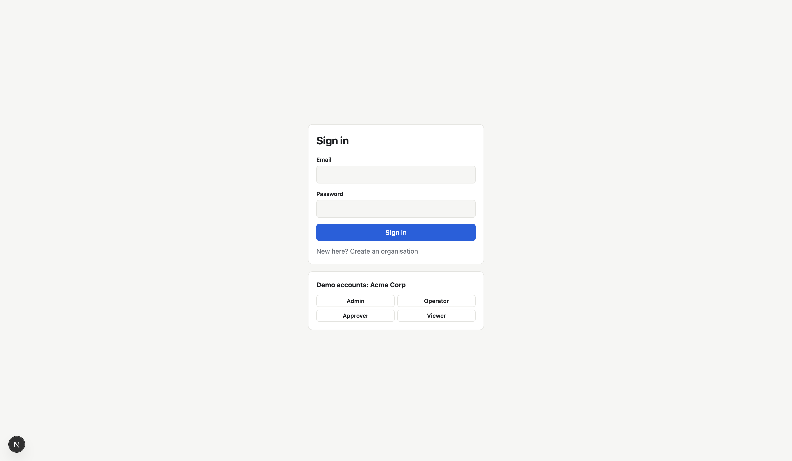

### Agent dashboard

Registered agents, their status and run totals. This was taken before the LangGraph fallback was added, so its two runs show as failed.

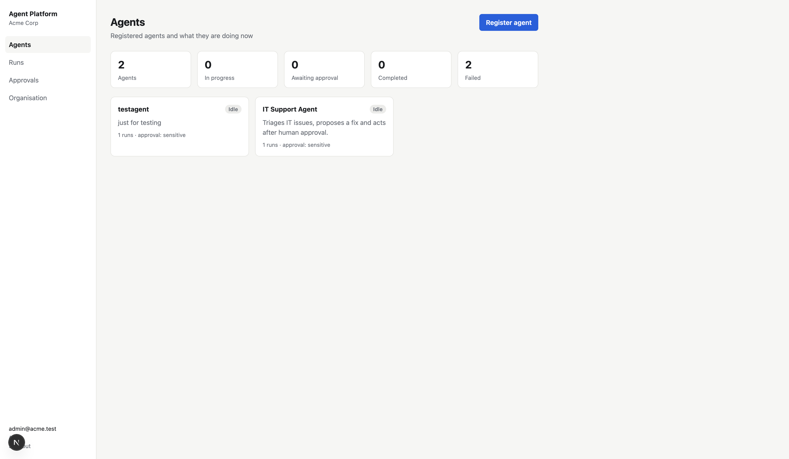

### Register an agent

Both engines are set up on every agent, with the model, prompt, approval policy and allowed actions.

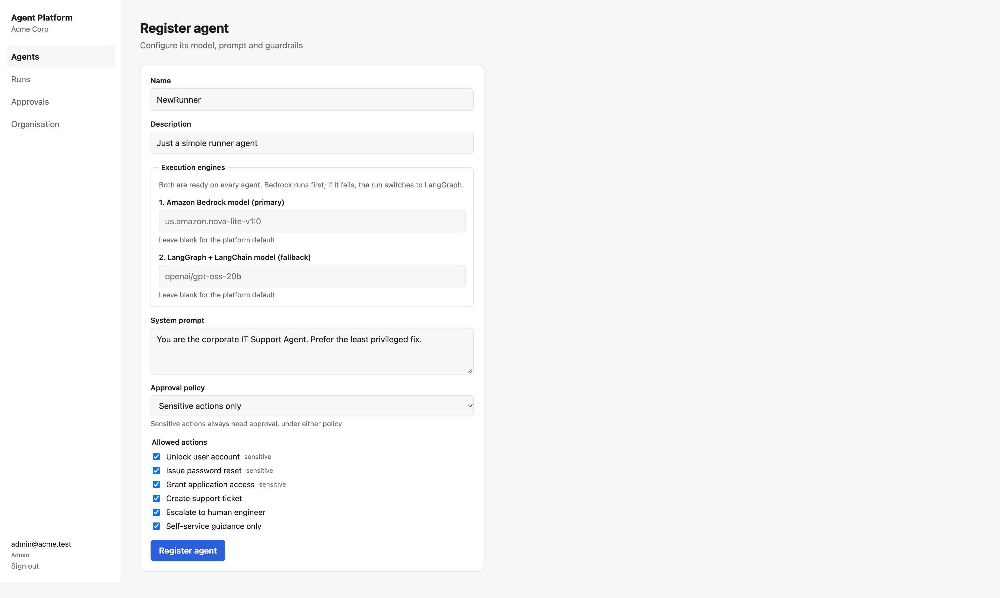

### Submit a request

Type a request for the agent and see its engine order and recent runs.

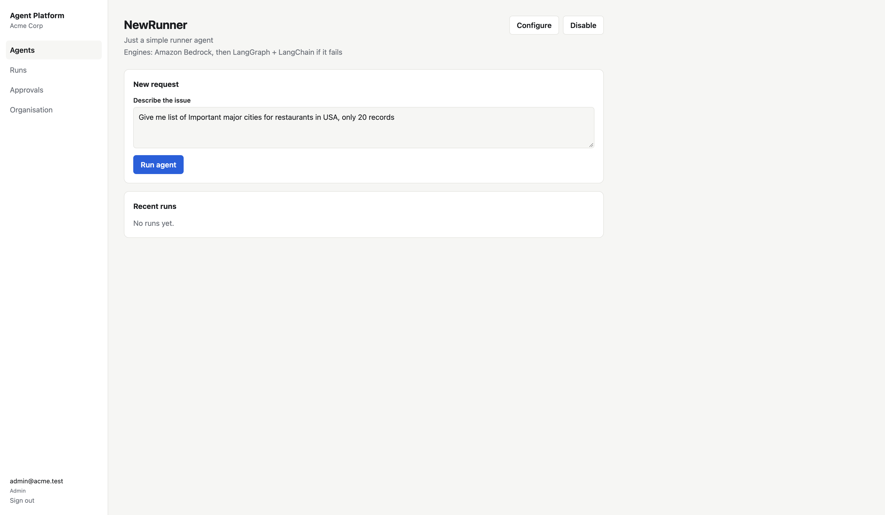

### Run switched to LangGraph

Bedrock failed, so the run continued on LangGraph + LangChain and completed. The banner and trace show why it switched.

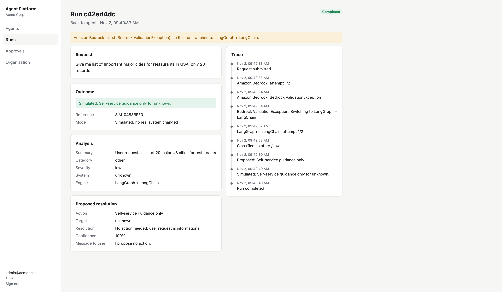

### Run history

Filter runs by status. This was taken before the fallback was added; newer versions also have an Engine column.

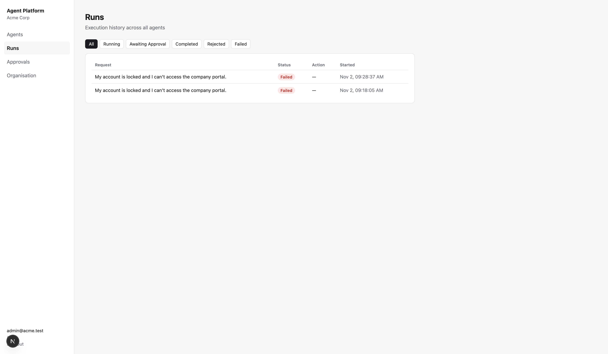

### Approvals

The queue of actions waiting for a human decision.

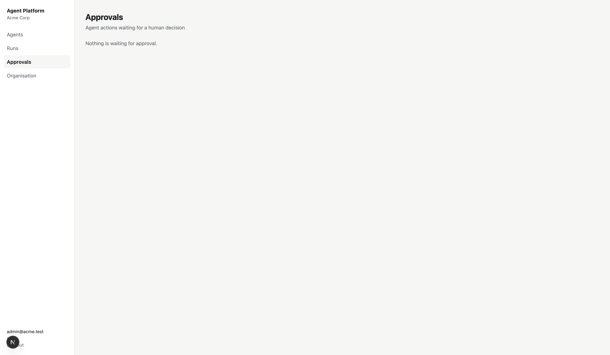

### Organisation and audit log

Manage members and roles, and read the audit log.

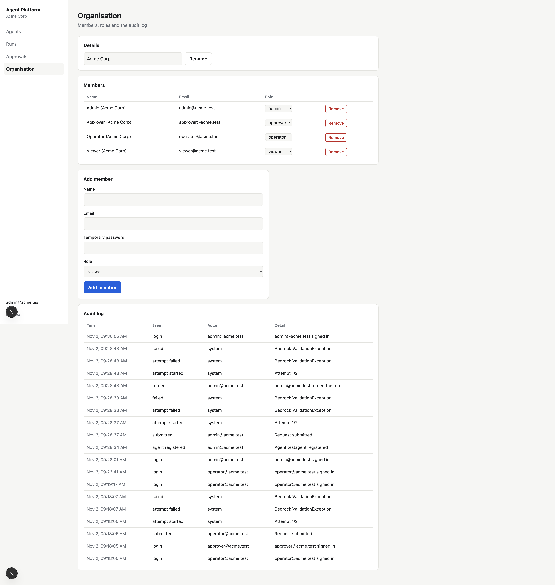

### Failed run

A failed run shows its reason and full trace, with a **Retry run** button. This was taken before the fallback was added, when a Bedrock failure ended the run.

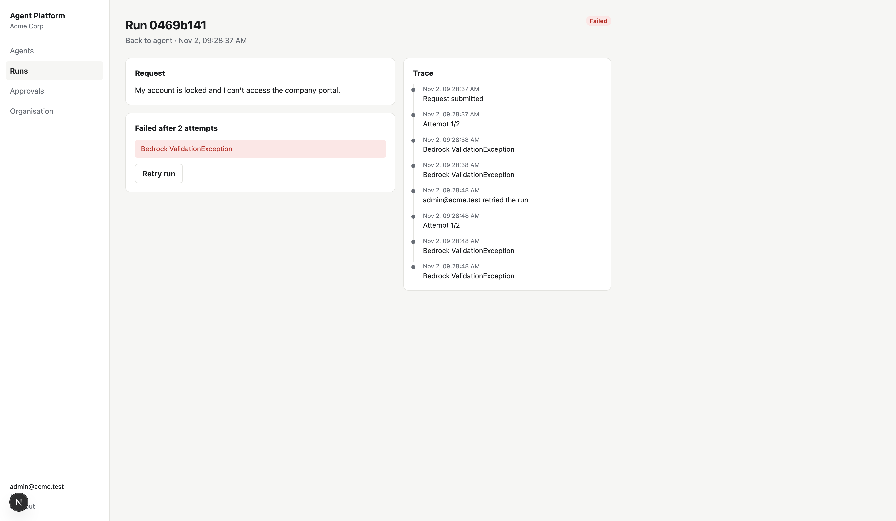

## Current status

| Area | State |
| --- | --- |
| API, RBAC, tenant isolation, approvals, retries, engine switching | Covered by 15 passing tests, with both engines stubbed |
| Frontend | Tested end to end in a real browser, including the switching dialog and approval |
| LangGraph + LangChain engine | **Working.** Real model calls through Groq, including a full approval run |
| Amazon Bedrock engine | **Blocked.** The AWS account is not authorised to call models (see below), so every run currently switches to LangGraph |
| PostgreSQL, Cognito mode | Implemented but not yet run |

## How the two engines work

Every agent has both engines ready. You can set a model for each when registering it, or leave them blank
to use the platform defaults.

1. Every new run tries **Amazon Bedrock** first. This includes re-runs from the **Retry run** button.
2. If Bedrock fails, the run changes to `switching_engine`, and the run page shows a 3-second dialog:
   "Switching to LangGraph and LangChain".
3. The run then continues on **LangGraph + LangChain**, and the page shows which engine was used and why.
4. If both engines fail, the run is marked `failed`.

Only model failures cause a switch. If an action itself fails, the engine is not changed, so an action is
never repeated on the other engine. An approved action runs on the engine that proposed it.

LangGraph only orchestrates steps, so the fallback still needs a model. It uses LangChain's `ChatGroq` with
`GROQ_API_KEY`, which keeps it working when AWS is the problem. **On the fallback, request text is sent to
Groq, outside AWS.** Without `GROQ_API_KEY`, a Bedrock failure ends the run as `failed`.

The code is kept separate:

| File | Purpose |
| --- | --- |
| `src/ai_maneger/engines/bedrock_engine.py` | Primary engine: agent steps on Bedrock Converse |
| `src/ai_maneger/engines/langgraph_engine.py` | Fallback engine: LangGraph workflow with LangChain model calls |
| `src/ai_maneger/engines/__init__.py` | Engine registry and the order they are tried in |
| `src/ai_maneger/workflow.py` | Shared actions, prompts, guardrails and agent steps |
| `src/ai_maneger/service.py` | Runs engines in the background and handles the switch |

### AWS access check (2026-11-02)

| Capability | Result |
| --- | --- |
| Credentials (STS) | Valid |
| Bedrock: list models and inference profiles | Allowed |
| Bedrock: call a model (`Converse`) | **Refused** with `ValidationException: Operation not allowed` |
| AgentCore: list runtimes, memories and gateways | Allowed; the account has none in `us-east-1` or `us-west-2` |
| AgentCore: create or invoke | Not tested; creating resources was not attempted |

Model calls were refused for Amazon, Anthropic, Meta, OpenAI and other providers, in both `us-east-1` and
`us-west-2`. For the three models checked, `GetFoundationModelAvailability` reports
`authorizationStatus: NOT_AUTHORIZED` while agreement, entitlement and region are all `AVAILABLE`. The model
access use-case form has also not been filled out for this account.

To clear it, the account owner should complete the model access form in the Bedrock console. If calls are
still refused, check the account's billing status or open an AWS Support case. Runs that failed can then be
re-run with the **Retry run** button.

AgentCore is not used by this code yet.

## Architecture

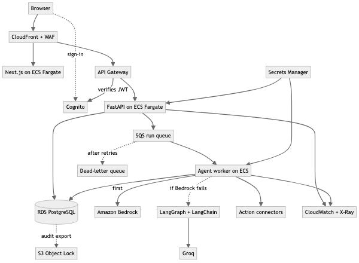

The repo today runs the API and worker in one process, with `asyncio` tasks in place of SQS. `service.spawn()`
is the only line that would change.

### Agent workflow

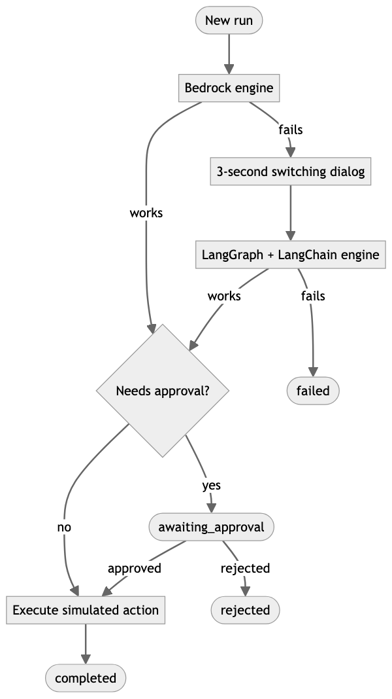

Diagram sources are in [docs/architecture.mmd](docs/architecture.mmd) and [docs/agent-workflow.mmd](docs/agent-workflow.mmd).

### Key decisions

- **Approval is a durable stop, not a paused process.** The graph ends and the run is saved as
  `awaiting_approval`, so an approval can arrive days later or after a restart.
- **The model only proposes.** Its output is schema-validated, its action must be on the agent's allowlist
  (anything else escalates to a human), and the code decides whether approval is needed.
- **Fallback is always visible.** A switch is shown to the user, saved on the run and written to the audit
  log, so approvers can see which engine produced a proposal. If both engines fail, the run is `failed`.
- **Status changes use compare-and-swap,** so two approvers clicking together can't execute an action twice.

## Security and reliability

| Concern | This repo | Production |
| --- | --- | --- |
| Authentication | JWT login with scrypt-hashed passwords. `AUTH_MODE=cognito` verifies Cognito tokens via JWKS | Cognito with SAML/OIDC SSO and MFA |
| Authorisation | Server-side permission matrix: admin, operator, approver, viewer | Same, with roles from Cognito groups |
| Tenant isolation | Tenant comes from the verified token, never the request. Every query is scoped, and other tenants' rows return 404 | Add PostgreSQL row-level security |
| Human approval | Sensitive actions always need approval, and policy can only tighten this. Requesters can't approve their own runs | Add approval expiry and multi-step approval |
| Failed runs | Model calls retry on transient errors, then the run switches engine. Action failures retry with backoff. Failed runs can be re-run, and in-flight runs resume on startup | SQS with a dead-letter queue, plus idempotency keys on real connectors |
| Audit and tracing | Append-only event log per run and tenant; request ids on every response | Export to S3 Object Lock; CloudWatch, X-Ray and Bedrock invocation logging |
| Secrets | `.env` is git-ignored, keys are `SecretStr`, and tenants see only Bedrock error codes, not ARNs | Task roles and Secrets Manager, with no long-lived keys |
| Prompt injection | User text is delimited and treated as data; the allowlist and approval gate limit the damage | Add Bedrock Guardrails |

### Supporting multiple customers securely

1. **Identity:** one Cognito user pool per environment, with `custom:tenant_id` writable only by admins and
   one federated identity provider per customer.
2. **Data:** a shared schema protected by row-level security, using a per-request `app.tenant_id` setting as a
   second line of defence behind the application's query scoping.
3. **Higher-tier isolation:** regulated customers get a dedicated database or AWS account, routed by tenant.
4. **Fair use:** per-tenant API Gateway usage plans, run quotas and Bedrock spend attribution.
5. **Encryption and audit:** per-tenant KMS keys for sensitive fields, and tenant-partitioned audit exports.

## Summary

**Completed:** the web app, REST API, IT Support Agent, Bedrock engine with LangGraph fallback, async execution,
persistent history, approvals, retries, validation, tenant and role management, audit log and tests.

**Remaining:**
- Clear the AWS model access block and test the Bedrock engine against real models.
- Decide whether to host the agent on Bedrock AgentCore Runtime.
- Run against PostgreSQL and a real Cognito user pool.
- Write infrastructure as code and deploy to a test environment.

**Would improve for production:**
- Replace the Groq fallback with an in-AWS option if data must stay inside AWS.
- Move execution to SQS workers.
- Add Alembic migrations, in place of `create_all` on startup.
- Add PostgreSQL row-level security.
- Rate-limit login and move tokens out of `localStorage`.
- Push live updates over SSE or WebSockets instead of polling.
- Add frontend end-to-end tests and a model evaluation suite.
